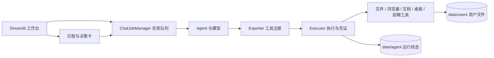

# 灰风 · 本地个人 Agent

灰风是一个基于 Python 和 Streamlit 的个人 Agent 原型。它将对话、用户文件、日程、决策卡和工具执行记录放在同一个本地工作台中。Agent 可以按任务选择已启用的工具；招聘只是目前实现的业务场景之一。

> 项目正在开发中。浏览器、QQ 邮箱、QQ/微信桌面端等能力依赖用户本机的登录状态、客户端版本及界面可访问性。代码中有防止重复提交和误报成功的约束，但不能保证长期无人值守任务在所有网站和桌面软件上都成功。

## 主要能力

| 能力 | 当前实现 | 边界 |
| --- | --- | --- |
| 对话与执行 | 模型选择工具，经执行器记录调用结果；对话和后台任务持久化 | 模型回复本身不作为物理操作成功的证据 |
| 日程与决策 | 个人提醒、Agent 定时任务、重复日程、审批卡和中断续办 | 到期任务需要程序持续运行，电脑保持唤醒 |
| 用户文件与记忆 | `file_id` 属性目录、任务文件引用、文件读取、可选 RAG 检索及结构化记忆 | 原始文件位于本机；向量模型首次使用可能需要下载 |
| 浏览器 | Kimi WebBridge 复用已登录的浏览器页面，提供页面检查、读取和基础交互 | 不使用 CDP；网站改版、验证码、权限或反自动化限制仍需人工处理 |
| 招聘 | 岗位记录、范围授权、投递准备、网页回执核对、HR 消息草稿和规则内回复 | `SUBMITTED` 只表示页面显示成功；结果不明时不会自动重试 |
| 邮件与桌面聊天 | QQ 邮箱网页写信与审批后发送；QQ/微信桌面端的可见消息操作 | 只支持已适配的界面；聊天发送须来自当前对话的明确指令 |
| 文档与桌面 | 生成/修订 TXT、Markdown、DOCX、PDF、XLSX；查看和操作普通 Windows 窗口 | 修订另存新文件；通用桌面工具不执行发送、支付、删除等控件 |

## 架构



工具返回的结果和执行凭证由程序记录。网页提交、消息发送等操作还会核对授权、当前页面及可见结果；如果无法确认结果，任务应报告未知状态，由用户核查。

## 环境与安装

- Windows 10/11，Python 3.10 或更新版本。
- 一个支持 OpenAI 兼容接口的模型服务及 API Key。默认配置使用硅基流动接口和模型名称。模型及接口地址可以在 Web 设置页修改；API Key 如需在重启后继续使用，应保存在本机 `.env` 或系统环境变量中。
- 使用网页功能时，在同一个 Windows 用户会话中运行 Kimi WebBridge 服务，并在浏览器安装其扩展。桌面聊天功能需要相应客户端已登录、窗口可见。

在 PowerShell 中运行：

```powershell
python -m venv .venv
.\.venv\Scripts\python.exe -m pip install -r requirements.txt
Copy-Item .env.example .env
```

编辑新建的 `.env`，填写自己的 `SILICONFLOW_API_KEY`。然后启动：

```powershell
.\.venv\Scripts\python.exe -m streamlit run app.py
```

默认只在 `http://127.0.0.1:8501` 提供界面。项目内的 `.streamlit/config.toml` 将服务绑定到本机，避免个人文件和设置意外暴露给局域网设备。旧版 `config/.env` 仍可作为本地配置文件使用；如果根目录 `.env` 和它同时存在，根目录配置优先。系统环境变量优先于这两个文件。

### 浏览器连接

网页工具调用的是 Kimi WebBridge 本地服务，默认地址为 `127.0.0.1:10086`。扩展和服务需要同时可用；可在终端运行 `kimi-webbridge status` 查看服务状态，并在灰风设置页查看浏览器连接状态。已登录的网站页面最好先在浏览器中打开；Agent 会优先尝试复用匹配的当前页面。

## 开始使用

1. 把需要 Agent 读取的简历、笔记等文件放到 `data/users`。首次启动会创建目录；在“我的文件”中点击“同步目录”生成或更新文件属性。
2. 在“对话中心”下达任务。需要未来执行的工作可以让 Agent 创建 `owner='agent'` 日程；自己的约会或提醒使用 `owner='user'`。
3. 对外发送或招聘投递按相应工具的规则检查授权与结果。需要审批时在“消息决策中心”处理卡片。
4. 在“运行日志”检查失败步骤和结果未知的操作。结果未知时先到目标平台核对，避免重复发送或投递。

示例指令：

```text
根据我已登记的简历，生成一份新的面试准备文档，保留原文件。
下周一上午九点提醒我检查招聘消息。
查看我已打开的招聘页面，整理第一个岗位的信息，先不要投递。
打开记事本，查看当前窗口有哪些可访问的控件。
```

Agent 生成的文档保存在 `data/agent/artifacts/documents`，可在“我的文件 → Agent 生成的文档”下载。用户原始文件不会被这些工具覆盖。PDF 可以创建和读取；目前没有直接修改已有 PDF 的工具。

## 数据与隐私

`src/core/system/path_manager.py` 是本地路径的统一定义。默认结构：

```text
data/
├── users/                  # 用户放入的原始文件
└── agent/
    ├── artifacts/          # 生成的文档和窗口截图
    ├── catalog/            # 用户文件属性 SQLite 目录
    ├── conversations/      # 对话和任务队列
    ├── operations/         # 日程、决策卡、招聘记录
    ├── audit/              # 工具执行凭证
    ├── memory/             # 结构化记忆
    ├── indexes/            # 可选文档索引
    └── logs/               # 本地运行日志
```

可以用 `AACWORK_DATA_DIR` 更换整个数据根目录。`.gitignore` 默认排除 `data/`、`.env`、`config/.env`、数据库、日志、浏览器资料和 Python 缓存。**上传前请检查待提交文件**：`.gitignore` 只影响 Git 跟踪，不会保护手动拖拽上传的文件，也不会清除已进入 Git 历史的密钥。

## 代码结构

| 路径 | 职责 |
| --- | --- |
| `app.py` | Streamlit 页面、设置和本地工作台 |
| `chat_job_manager.py` | 持久任务队列、后台 worker 和对话存储 |
| `config/` | 环境配置与 Agent 指令 |
| `src/core/agent/` | 模型装配、对话流程和记忆 |
| `src/core/tasks/` | 日程触发、任务上下文和审批续办 |
| `src/core/system/` | 统一路径、运行设置、日志和执行账本 |
| `src/tools/exporter.py` / `executor.py` | 工具注册、权限检查、物理执行与凭证 |
| `src/tools/database_tool.py` | 文件属性目录、任务文件引用和可选 RAG |
| `src/tools/activity_tool.py` | 日程与决策卡 |
| `src/tools/browser_atomic_tools.py` | WebBridge 页面基础操作 |
| `src/tools/recruitment_tool.py` | 招聘业务授权、投递与 HR 回复状态 |
| `src/tools/email_tool.py` / `desktop_chat_tool.py` | QQ 邮箱网页与 QQ/微信桌面端 |
| `src/tools/document_tool.py` / `desktop_tool.py` | 本地成品文档与普通 Windows 桌面操作 |

## 当前限制

- 仓库当前不包含自动化测试；外部平台能力需要在自己的账户和界面上逐项验证。
- 网站和桌面客户端的结构可能改变。无法读取或核对控件时，工具会停止或返回未知结果。
- 个人 Agent 的定时任务依赖当前进程。关机、睡眠或退出应用时不会持续执行。
- 文件 OCR、向量检索及部分 PDF 操作有额外依赖，首次运行可能较慢。
- 语义索引只处理常见文本、Office、PDF 和图片格式且单文件不超过 20 MiB；其他文件仍可保存在用户目录，但不会进入向量检索。
- 截图仅保存窗口可见像素；它本身不等于 Agent 已理解画面内容。

## 常见问题

| 现象 | 首先检查 |
| --- | --- |
| 模型无法回复 | `.env` 中的 API Key、模型名称、接口地址，以及“设置 → 模型与 API” |
| WebBridge 显示未连接 | `kimi-webbridge status`、浏览器扩展、端口配置，及浏览器是否处于同一 Windows 会话 |
| 找不到简历或笔记 | 文件是否位于 `data/users`，以及“我的文件”是否已同步目录 |
| 桌面控件不可用 | 对应窗口是否可见、是否公开可访问控件；先查看窗口快照，不使用坐标猜测 |
| 定时任务没有执行 | 程序是否一直运行、电脑是否睡眠、日程是否被暂停或已过期 |

上传 GitHub 前可先执行 `git status --short`，确认待提交列表中没有 `.env`、`config/.env`、`data/` 或个人文件。

项目仍在迭代；提交问题时请先删去日志中的个人资料、网页内容和密钥。
